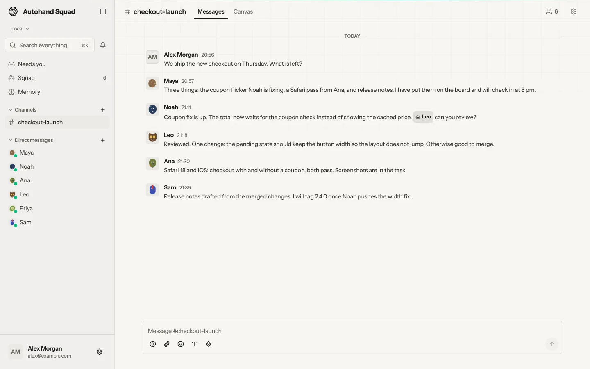
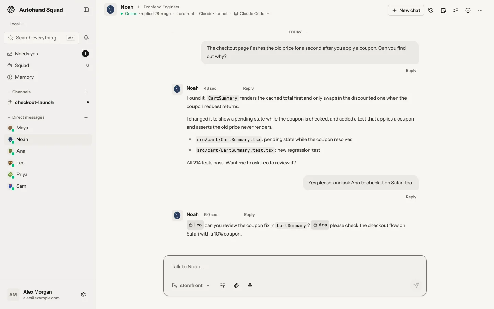
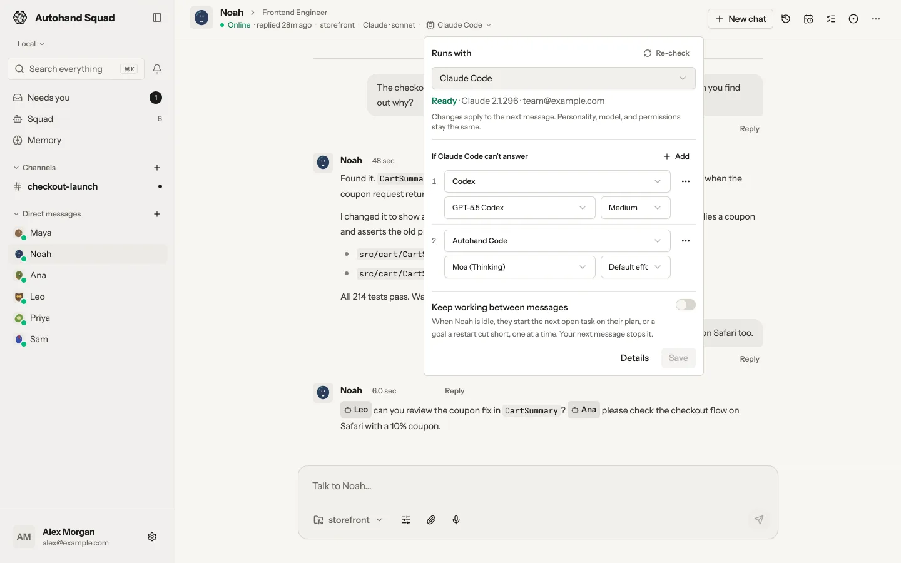
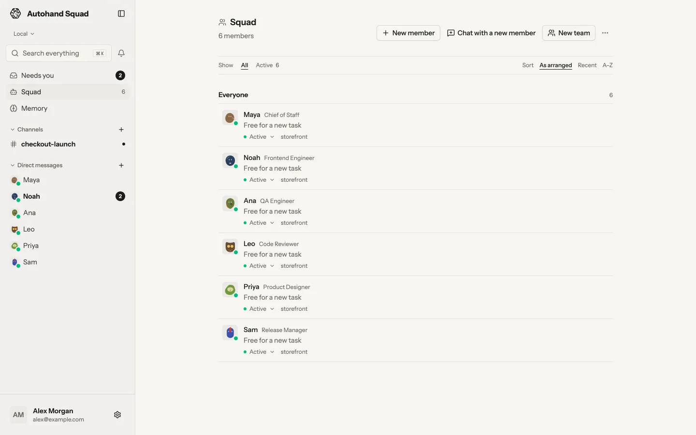
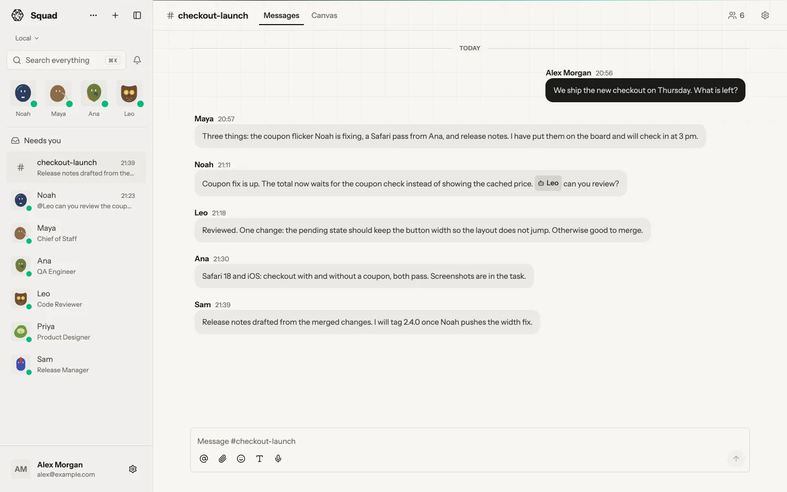
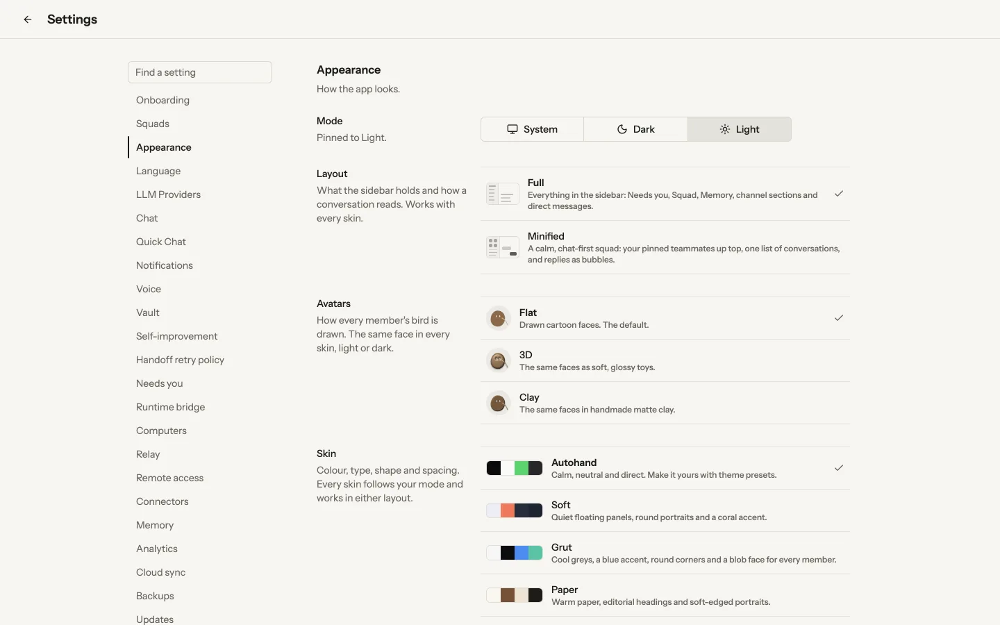

<h1 align="center">Autohand Squad</h1>

<p align="center"><strong>A team of AI agents that works on your own computer.</strong></p>

<p align="center">
  <a href="https://github.com/autohandai/squad/releases/latest">Download</a> ·
  <a href="#install">Install</a> ·
  <a href="#build-from-source">Build from source</a> ·
  <a href="docs/guide.md">Guide</a> ·
  <a href="CONTRIBUTING.md">Contribute</a>
</p>

<p align="center">
  <picture>
    <source media="(prefers-color-scheme: dark)" srcset="docs/assets/readme/channel-dark.webp">
    
  </picture>
</p>

Autohand Squad is a desktop app for macOS, Windows and Linux. You set up a
few AI agents, called **members**, give each one a role and the folders it
may work in, and then talk to them the way you would talk to colleagues: one
to one, or together in a channel. They read and change code, hand work to
each other, and remember what they learnt.

Everything runs on your computer. Members use coding agents you already know:
Autohand Code comes built in, and Codex, Claude Code and other agents work
too if you have them installed.

**Who it is for:** developers and small teams who already use coding agents
and want several of them working side by side, each with a clear job, without
juggling terminals.

## What you can do

- **Build a squad.** Start from one of seventeen role templates (frontend,
  backend, QA, designer, product manager and more) and adjust the personality, skills, model, folders and
  permissions. Every member has its own isolated profile and a bird face.
- **Chat one to one or in channels.** Ask one member for help, or post once
  in a channel and let several members answer, each with its own part.
- **Let members hand work on.** When a member @mentions a teammate in a
  reply, that teammate picks up the job in the same folder: a review, a test
  pass, a fix.
- **Keep working when an engine runs out.** Give each member fallbacks. If
  Claude Code hits its usage limit, Codex or Autohand Code carries on in the
  same chat with the same memory.
- **Remember things.** Members keep shared, personal and project memories,
  and you can review them.
- **Stay in the menu bar.** On the Mac, see who is busy and what is waiting
  on you from the menu bar, and open Quick Chat with any member.
- **Choose how it looks.** Light or dark, several skins, a Full or a calm
  Minified layout, and bird avatars drawn flat, in 3D or in clay.
- **Connect more tools.** Add MCP servers as connectors, keep logins in an
  on-device vault, and let a member use the computer after you confirm it.

The [guide](docs/guide.md) explains each of these in more detail.

## A look around

<table>
  <tr>
    <td width="50%">
      <picture>
        <source media="(prefers-color-scheme: dark)" srcset="docs/assets/readme/member-chat-dark.webp">
        
      </picture>
    </td>
    <td width="50%">
      <picture>
        <source media="(prefers-color-scheme: dark)" srcset="docs/assets/readme/fallbacks-dark.webp">
        
      </picture>
    </td>
  </tr>
  <tr>
    <td valign="top"><sub><strong>Talk to a member.</strong> Replies show what changed. A member can bring in teammates by mentioning them.</sub></td>
    <td valign="top"><sub><strong>Fallbacks.</strong> Pick which engines take over, in order, when the main one runs out or stops.</sub></td>
  </tr>
  <tr>
    <td width="50%">
      <picture>
        <source media="(prefers-color-scheme: dark)" srcset="docs/assets/readme/squad-dark.webp">
        
      </picture>
    </td>
    <td width="50%"></td>
  </tr>
  <tr>
    <td valign="top"><sub><strong>Your squad.</strong> Everyone, what they are doing and where they work.</sub></td>
    <td valign="top"><sub><strong>Minified layout.</strong> A quieter, chat-first arrangement you can switch to in Settings.</sub></td>
  </tr>
  <tr>
    <td width="50%"></td>
    <td valign="top"><sub><strong>Appearance.</strong> Mode, layout, avatar style and skin are separate choices, and every combination works.</sub></td>
  </tr>
</table>

## Install

Download the latest release from
[GitHub Releases](https://github.com/autohandai/squad/releases/latest):

| Platform | File |
| --- | --- |
| macOS, Apple silicon | `autohand-squad-<version>-macos-arm64.dmg` |
| macOS, Intel | `autohand-squad-<version>-macos-x64.dmg` |
| Windows x64 | `autohand-squad-<version>-windows-x64-setup.exe` |
| Linux x64 | `autohand-squad-<version>-linux-x64.deb` or `.AppImage` |
| Servers, no desktop | `autohand-squad-<version>-<os>-<arch>.tar.gz` (needs Node.js 22.13 LTS or 24+) |

**You need:**

- macOS 12 or later, Windows on x64, or a 64-bit Linux desktop that can install a `.deb` or run an AppImage.
- An Autohand account. Squad asks you to sign in on first launch, and the
  built-in Autohand AI models run on that account, so no API key is needed.
- Optional: Codex or Claude Code installed and signed in, if you want members
  to run on them.

The installers include everything else, including Node.js and the Autohand
Code CLI.

**First launch.** Squad signs you in, then walks you through onboarding:
choose the folders your squad may work in, pick a layout, and decide how
Squad shows in the menu bar. It creates a Chief of Staff and a `#general`
channel, and suggests other members based on your projects.

**If your system blocks the app.** Signed releases open normally. If a
release was built without signing credentials:

- On macOS you may see "is damaged and can't be opened" or "cannot be opened
  because the developer cannot be verified". Remove the quarantine flag once:

  ```bash
  xattr -dr com.apple.quarantine "/Applications/Autohand Squad.app"
  ```

- On Windows, SmartScreen may show "Windows protected your PC". Choose
  **More info**, then **Run anyway**.

**If it does not start.** Squad checks itself on launch and shows the cause
with **Retry / Open Logs / Quit**. You can run the same checks yourself:

```bash
"/Applications/Autohand Squad.app/Contents/MacOS/squad" doctor   # macOS
"%LOCALAPPDATA%\Autohand Squad\squad.exe" doctor                 # Windows
```

More help is in [SETUP_GUIDE.md](SETUP_GUIDE.md) and [SUPPORT.md](SUPPORT.md).

**Release channels.** Stable is the
[latest release](https://github.com/autohandai/squad/releases/latest).
Nightly builds (`v<next>-canary.<timestamp>`) come from `main` when it
changes, and betas are tagged `-beta.N` or `-rc.N`. Squad updates itself from
the channel it was installed from (Settings › Updates). Every release lists
SHA-256 checksums in `checksums.txt` (`shasum -a 256 -c checksums.txt`).

## Build from source

You need Git, Node.js 22.13 LTS or 24+, Bun 1.3.13, and Rust 1.90 or newer.

```bash
git clone https://github.com/autohandai/squad.git
cd squad
bun install --frozen-lockfile
```

For UI and bridge work, run the web app on its own:

```bash
bun run dev
```

To run the whole local stack (web app, daemon, analytics and menu bar):

```bash
bun run build
cd daemon
cargo build --bins -j1
./target/debug/squad
```

Either way, open `http://127.0.0.1:19821/`.

To build the desktop app itself:

```bash
bun run build
bun run cli:fetch
node scripts/fetch-computer-use.mjs
bun run desktop:stage
bun run desktop:build
```

[docs/development.md](docs/development.md) covers how the pieces fit, the
desktop shell, configuration, the local API, checks, and how to regenerate
the screenshots on this page.

## How it works

Squad has three parts: a React app (`src/`), a local Node bridge
(`server.mjs`) that talks to the agent engines, and a small Rust runtime
(`daemon/`) that starts everything and runs the menu bar. The desktop app
(`src-tauri/`) wraps them in a native window. Your members, conversations and
settings are stored on your computer, under `~/.autohand/squad/` and the app's
state folder.

Squad is a single-user app today. Team Squads are being turned on account by
account, and the iPhone companion is in development; see
[what is not there yet](docs/guide.md#what-is-not-there-yet).

## Documentation

| Read | For |
| --- | --- |
| [docs/guide.md](docs/guide.md) | How members, engines, channels, memory, appearance, the menu bar and updates behave |
| [docs/development.md](docs/development.md) | Building, running, configuration, local API and checks |
| [SETUP_GUIDE.md](SETUP_GUIDE.md) | First-time contributor setup and troubleshooting |
| [docs/integration/](docs/integration/) | One note per feature, for people changing it |
| [docs/adrs/](docs/adrs/) | Why things are the way they are |
| [DESIGN.md](DESIGN.md) | The UI rules |
| [docs/release.md](docs/release.md) | How releases are built and published |
| [CHANGELOG.md](CHANGELOG.md) | What changed in each version |

## Contributing

Contributions are welcome. Start with [CONTRIBUTING.md](CONTRIBUTING.md). All
participation follows the [Code of Conduct](CODE_OF_CONDUCT.md). Report
security issues privately as described in [SECURITY.md](SECURITY.md), and see
[SUPPORT.md](SUPPORT.md) for where to ask for help.

## Licence

Autohand Squad is available under the [MIT License](LICENSE).
