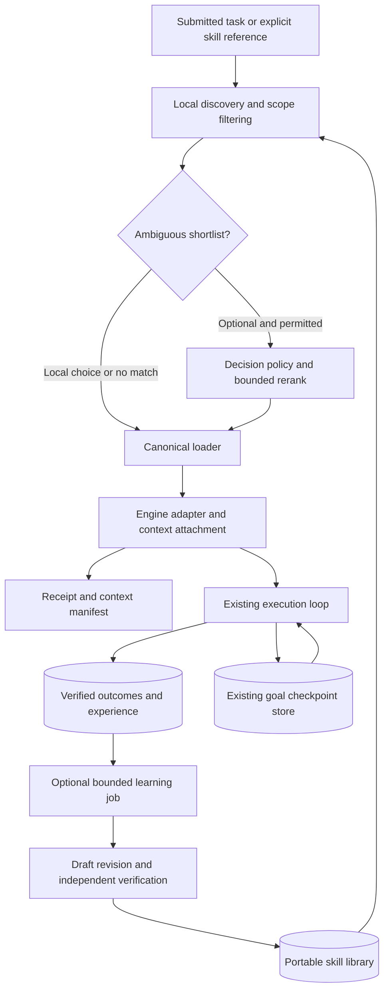

# Adaptive skills and durable task continuity

Status: **Accepted; implementation behind a reversible rollout flag** · design 2 November, implementation 3 November 2026

Autohand should open a conversation with a small discovery contract, find relevant skills from the complete authorized library, supply their instructions when needed, and retain useful procedures across sessions. Learning must reflect verified work. Restoring an unfinished goal must restore its approved intent and checkpoint without silently restarting execution.

The user approved implementation on 3 November 2026. This design covers the shared runtime contract and its CLI and Squad adapters. Implementation preserves existing learning and sharing preferences; paid inference evaluation, publication, and deployment remain separate actions. The [research evidence](../../reports/skills-research-2026-11-02/README.md) and [evaluation contract](2026-11-02-adaptive-skills-evaluation.md) accompany this design.

## Decisions

1. Keep portable `SKILL.md` packages. Replace the opening catalog with host retrieval and a bounded discovery contract.
2. Extend existing skill, experience, goal, and receipt modules. Introduce no parallel goal supervisor, memory database, or research executor.
3. Separate skill identity, package revision, and current location. Pin exact revisions when a run depends on them.
4. Separate loading, application, task success, and demonstrated benefit. None implies the next.
5. Learn bounded, versioned improvements from verified nontrivial work. New procedures begin as drafts.
6. Make local selection the default. Optional decision models never become a prerequisite for discovery or continuity.
7. Enforce the user's Weka boundary at dispatch: the actual active execution provider must be Autohand AI Cloud and the account must be eligible. An Autohand login or model override alone grants no eligibility.
8. Restore compact goals in a paused state under the existing ownership model. Resume rechecks current context, permissions, and uncertain effects.

## Problem and evidence

The local greeting audit at CLI commit `6d973c50` recorded three native tools, one model request, and 80,880 message characters, including 47,678 characters of skill descriptions. These are request-character measurements, not billed-token results. Tool transport is already compact; the eager skill roster remains a large startup cost. See the [captured audit](../../reports/skills-research-2026-11-02/hello-context/FINDINGS.md).

The CLI already has 14 built-in skills, registry installation, local authoring, skill matching, and `/deep-research`. The command activates the existing bundled workflow; discovery must point to it rather than build another research orchestrator. The similarly named research packages shown in the earlier screenshots came from external Codex/Agents skill directories. Name alone cannot establish provenance or equivalence.

The present activation path records `outcome: succeeded`, and learned-capability scoring counts those events as successful uses. That proves activation succeeded, not that a user's task passed. Migrating these counts into quality evidence would perpetuate the wrong signal.

Squad already defines local skill snapshots (ADR-0039), durable goals and restart pausing (0066), explicit teaching deliveries (0139), opt-in cloud memory sync (0152), honest work receipts (0153), and scoped local retrieval (0156). This design extends those contracts.

## Scope and invariants

| Requirement | Contract |
| --- | --- |
| S1: bounded startup | Opening skill overhead is independent of library size. Proposed initial budget: at most 512 tokens under the main model's tokenizer. This is a skill-only budget, not a whole-prompt promise. |
| S2: complete discovery | Every enabled, authorized local skill is searchable even if absent from startup context. Explicit invocation bypasses ranking. |
| S3: complete required instructions | Supply the selected skill's required instructions intact. Optional references load as needed; no silent summarization to fit a cap. |
| S4: stable tool interface | Use the existing code-mode discovery/execution bridge. Catalog changes must not expand or reorder native tool schemas. |
| S5: evidence honesty | A file read, a supplied packet, a model request, and a verified outcome have distinct receipts. Never claim the model complied merely because instructions were supplied. |
| S6: strict provider isolation | Non-Autohand execution providers cause zero Weka calls across selection, previews, learning, and compaction, including retries. |
| S7: durable knowledge | Skills and their revisions persist independently from chat history. A moved workspace changes its locator, not historical identity. |
| S8: durable intent | Goal checkpoints remain authoritative in existing goal stores. A memory summary cannot create, complete, resume, or take ownership of a goal. |
| S9: private by scope | Authorization filters precede ranking. Personal or isolated-member knowledge is not automatically shared, synced, taught, or published. |
| S10: reversible learning | Each learned change has lineage, evidence, an immutable revision, and a rollback path. Source-task success alone cannot make it preferred. |

Non-goals: a trained router, a new knowledge graph, automatic public skill publication, automatic cross-member teaching, autonomous resumption after a crash, universal control of an external engine's context, or a replacement for existing command executors. Remote MCP skills can be a later adapter; their current Beta extension is not required by the initial implementation.

## Architecture and ownership

| Responsibility | Owner and boundary |
| --- | --- |
| Inventory, identity, locators, installation | Extend the CLI skills registry/tooling and Squad local-skills adapter. Packages remain authoritative; indexes are rebuildable. |
| Retrieval and selection | Shared discovery policy over authorized metadata. Squad reuses the existing scoped retrieval/index infrastructure where applicable. |
| Loading and receipts | A small shared `SkillRuntime` contract concentrates resolution, preparation, and dispatch acknowledgment; engine adapters supply their actual capability. |
| Prompt placement | Existing context builders and compaction lifecycle. Preserve the stable leading policy and attach changing skill material through task context. |
| Outcome and learning | Extend experience/event history and existing skill-authoring facilities. Keep outcome recording separate from activation and extraction jobs. |
| Decision access | One shared policy gate at the transport boundary, used by every caller and retry. Individual features cannot independently authorize Weka. |
| Continuity | Existing CLI session/goal persistence and Squad bridge-owned goal manager. No second ownership authority. |
| UI | Project actual runtime receipts into existing CLI history and Squad work receipts. UI state is never the authority for attachment or goal ownership. |

The shared interface has three meaningful operations: **resolve** a reference under current scope; **prepare** a bounded packet for an exact revision; **acknowledge dispatch** with the adapter's observed attachment evidence. Discovery can return zero candidates. Experience recording is a separate operation and accepts independently produced outcome evidence. These are conceptual contracts, not proposed public method names or new native tools.

## Identity and data contracts

| Record | Required fields and semantics |
| --- | --- |
| Skill reference | Origin authority, stable package ID, optional pinned package revision, resource-relative path. Human names are aliases. |
| Package revision | Manifest digest over `SKILL.md` and all included resource paths/content; parent revision when adapted; format version. Scripts and reference edits also change the revision. |
| Locator | Current authorized local root, registry coordinate, or adapter resource identifier. Absolute historical paths are repair hints, never identity. |
| Catalog entry | Reference, concise name/description, declared applicability, source, scope, enablement, compatibility, and index revision. Generated tags cannot grant authority. |
| Attachment receipt | Task/session/request identity, exact package revision and resources, selection reason, adapter capability, attachment state, policy epoch, time, and content-manifest identity. |
| Experience event | Event ID, task/run/revision, load/application observations, outcome status, checks/artifacts, environment and scope, cost, correction/counterexample, and provenance. |
| Learning job | Source outcome ID, source revision, extractor version, permitted scope/provider, state, bounded evidence references, and idempotency key. |
| Goal checkpoint extension | Existing goal ID/version/owner plus compact approved intent, next step, completed-check references, pinned skill references, pending/uncertain effects, and workspace identity. |

Keep nearest-root unqualified aliases compatible with existing discovery. Qualified references expose distinct same-named packages. Deduplicate the same canonical reference/revision, not every equal display name or byte-identical package from different trust authorities. Installation or member snapshot copies preserve identity and lineage. They do not silently follow upstream changes during a run.

Moving a repository from Documents to Developer requires resolving the workspace and skill locators. Do not rewrite whole transcripts, infer that a missing directory was deleted, recreate an iCloud-era tree, or substitute another `research` skill by name. If an exact revision cannot be resolved, show the missing reference and offer an explicit revision change before continuation that depends on it.

## Selection and loading

1. Apply explicit user selections, exclusions, scope, enablement, and capability constraints.
2. Search the authorized local inventory using exact aliases and lexical ranking first. Improve metadata and applicability before adding embeddings. Optional semantic retrieval must earn its resource cost in evaluation.
3. Produce a small shortlist, including a valid no-match result. Confidence thresholds are calibrated on held-out tasks, not selected after viewing the test set.
4. Only ambiguous cases may use an enabled decision model. Send bounded task evidence and candidate metadata; never the entire library or conversation by default. A relative winner must also pass an applicability threshold.
5. At submission or a newly discovered task need, resolve through the canonical loader again. Preview decisions cannot bypass current revision, scope, provider, or permission checks.
6. Prepare full required instructions and directly required dependencies. If they exceed the available context budget, report the actual size and choose an explicit alternative; do not silently truncate constraints.
7. Attach once per revision/resource set to the current context manifest. A new task can retain a relevant packet without rereading it every turn. A dependency cycle, changed file, or inaccessible resource fails visibly and leaves no false loaded receipt.
8. On compaction or context rebuild, recompute what is actually present. Restore required active instructions by pinned reference when necessary. Historical receipts remain historical.

Registry search and metadata inspection do not install or execute a package. Download, replacement, and script execution follow existing authorization rules. Inspect origin, manifest, path containment, compatibility, and declared resources before activation. Skill prose cannot grant permissions or override higher-priority instructions. Retain original upstream packages; create versioned local derivatives when adaptation is useful.

### Attachment states

`discovered → selected → prepared → attached → submitted → engine-confirmed`, with rejection/cancellation possible before dispatch. Each state names an observation, not inferred cognition.

The built-in runtime can attest the packet in the provider request. An external Codex/Claude/ACP adapter may only attest that it supplied a file or launch instruction. Such adapters report **supplied** with confirmation unavailable, rather than claiming loaded. If the adapter cannot preserve a pin or observe context compaction, record that limitation. Learning attribution cannot assume stronger evidence than the adapter exposes.

## Optional decision models and Weka

| Actual active execution route | Decision behavior |
| --- | --- |
| Canonical Autohand AI Cloud, valid eligible account, online, feature enabled and background allowed | Local ranking by default; Weka may assist within configured latency and spend budgets. |
| Any other provider, with or without a valid Autohand account | Local ranking or an explicitly configured compatible decision model on that provider; **zero Weka dispatches**. |
| Other provider plus `AUTOHAND_TYPE_AHEAD_MODEL=weka` | Local fallback and a concise configuration explanation; override does not confer eligibility. |
| External engine whose actual provider cannot be attested | Ineligible for Weka. Do not infer eligibility from a member's former Autohand configuration or display label. |
| Signed out, invalid entitlement, offline, background disabled, or decision failure | Local path. No silent alternate-cloud fallback. |

The policy uses the **actual executing engine/provider**, including an engine fallback, rather than a mutable provider display name. A policy epoch changes on provider, account, workspace/scope, consent, or execution-route changes. Debounced jobs, retries, and transport dispatch check the current epoch and eligibility. A late result cannot influence a changed task, catalog, provider, or draft. Already-dispatched work cannot be unsent; account for it honestly and discard stale results.

Use a shared decision-provider/model concept with optional feature overrides. `AUTOHAND_TYPE_AHEAD_MODEL` chooses a model; it is not an authorization mechanism or a setting for the main coding model. Audit compaction as well as new features. Current internal Weka compaction and public documentation wording must be reconciled before release.

Local draft suggestions are the default. Sending an **unsubmitted draft** to a remote model requires an explicit preview setting that explains the destination. Enter never waits for a preview request. Submitted-task reranking and learning use their own existing/background controls and bounded budgets. Persisting a skill locally does not imply that the inference used to author it was local.

## Learning from verified work

`task outcome committed → optional extraction job → draft revision → verified for scope → preferred for scope`. Superseded and quarantined revisions remain inspectable for provenance but are not selected automatically.

- **Loaded/supplied:** instructions reached an observable adapter boundary. No success credit.
- **Applied:** a trace or artifact shows use. Attribution may remain uncertain.
- **Task verified:** independent observable acceptance checks passed in a recorded environment. This can support a candidate, even when no existing skill was used.
- **Benefit demonstrated:** fresh-task or held-out comparison supports better quality or lower cost in a declared scope. This can justify a preference within that scope.

When enabled, create at most one bounded improvement job after verified nontrivial work. Greetings, canceled runs, and merely clean process exits do not start learning. Explicit user requests to learn or create a skill remain available even when automatic learning is off; resulting unverified content is labeled a draft.

Prefer a useful example or applicability correction to an existing local skill, then a scoped derivative, then a new package for a distinct workflow. Capture the reusable procedure, preconditions, checks, and counterexamples rather than copying a transcript or answer. Project paths, credentials, customer data, and one-off specifics must not leak into a personal or public package.

Verification uses a fresh input and independently maintained acceptance checks for the exact candidate revision. Generated checks are supplemental; the learner cannot weaken the checks that approve its own change. A changed candidate loses its verification status until rechecked. Preferred status additionally requires predeclared held-out benefit, including negative-transfer checks. A model judging its own prose is not sufficient evidence.

Commit the outcome before scheduling extraction. Key the job by outcome, source revision, and extractor version. Stage candidate files, validate containment and manifest, then publish atomically with compare-and-swap against the expected parent. Two jobs cannot overwrite a user's edit. A crash after outcome persistence can retry extraction without publishing a duplicate. Failed extraction never changes task completion or blocks the user's answer.

Preserve current learning choices on migration. Do not enable new cloud jobs or sharing implicitly. Disabling a skill prevents selection without deleting its evidence. Deleting learning evidence removes derived ranking signals and queued jobs under the same scope; cloud/team deletion follows existing explicit sync and tombstone rules. Local learning is not team teaching: reuse ADR-0139's explicit delivery mechanism when the user chooses to teach.

## Goals and session continuity

On startup, restore only compact approved goal/checkpoint metadata and references. Do not load every historical skill or conversation into the opening prompt. Existing ownership and lease rules remain authoritative; a session cannot claim a live remote-owned goal.

After a restart, goals remain paused until the user resumes under the current goal contract. Resume verifies workspace identity, owner/lease, current permissions and provider, checkpoint version, pinned skill availability, and completed-check freshness. Permission grants are not copied between engines. If an external action was in flight at the crash, inspect its observable state before retrying. An unknown action is neither completed nor safe to replay merely because a summary says so.

Snapshot references to skills used at each checkpoint. Explicit upgrades create a new checkpoint and receipt; they do not rewrite old evidence. A user correction updates approved intent or invalidates a learned assumption within its scope. User steering is applied through the existing queue/turn boundary, not a second skills scheduler.

## Interaction design

Use existing typography and work receipts; do not add a dashboard of skill cards. The ordinary chat view shows only meaningful state:

| Moment | Example text |
| --- | --- |
| Optional local preview | `Suggested: systematic-debugging · built-in` |
| Confirmed request attachment | `Loaded systematic-debugging · built-in · this task` |
| External adapter handoff | `Supplied systematic-debugging · engine confirmation unavailable` |
| Local draft publication | `Saved draft skill: csv-validation · project` |
| Fresh verification | `Verified csv-validation for this project` |
| Goal recovery | `Restored goal · paused · checkpoint available` |

Details disclose origin, scope, exact revision, reason, current-vs-historical attachment, evidence, and costs where observable. Repeated reads of the same revision do not create duplicate loaded rows. No skill or tool activity is fabricated for a greeting.

Existing skill management should expose enabled/excluded state, source and scope, local reference, lineage, and rollback. Add controls within current settings: automatic learning, local versus model previews, optional decision provider/model, and budget. Provider restrictions are enforced below these controls. Explain a disabled Weka choice once; do not introduce a permission prompt on every turn.

## Failure, concurrency, and recovery

| Condition | Required result |
| --- | --- |
| Index absent/corrupt/stale | Rebuild from authorized sources; exact references remain usable. No stale ACL result leaks. |
| File changes between selection and attachment | Re-resolve the revision; reject or explicitly select the new revision. No old-digest receipt. |
| Same skill selected twice | Coalesce preparation/attachment for the same task, revision, and resource set; retain selection provenance. |
| Provider changes during debounce/retry | Cancel queued dispatch, reject stale result, and use local selection. |
| Registry unavailable | Installed/local skills work; no forced remote discovery. |
| Learning job crashes or races an edit | Retry idempotently or report conflict; preserve the user's package and source outcome. |
| Goal owned elsewhere | Show owner/current state; do not launch a second worker or replay effects. |
| Skill removed or no longer authorized | Exclude future attachment and derived retrieval results; retain only history permitted by retention policy. |
| Decision timeout or invalid response | Bound the failure, validate IDs against the shortlist, fall back locally, and report actual decision cost. |

## Migration, rollout, and rollback

1. **Measure and identify:** freeze request captures and catalog manifests; add canonical references and truthful receipt semantics. Existing activation counts migrate as legacy activation observations, never verified successes.
2. **Reduce startup context:** ship local retrieval, explicit lookup, canonical loading, and manifest tracking behind one reversible feature flag. Preserve old alias resolution and package files. Compare against the current eager roster.
3. **Record meaningful outcomes:** add independent verification references and revision-scoped experience. Do not silently promote old skills from existing counters.
4. **Enable bounded learning:** deliver draft staging, lineage, idempotent jobs, verification, and rollback. Retain existing opt-ins and authorization.
5. **Restore pinned references:** extend current goal checkpoints and adapters; preserve restart pause and explicit resume.
6. **Evaluate assisted selection:** only after local quality passes, test optional Weka and other eligible decision models. Provider-call isolation is a hard gate, regardless of quality gains.
7. **Consider remote skills adapters:** add MCP support independently, with its maturity and integrity limits documented.

Rollback disables retrieval/learning/assistance independently and restores the previous catalog prompt path if necessary. Keep portable packages and existing goal checkpoints readable. Never roll back by deleting user-authored skills, erasing evidence, or resetting permissions. A migration must be additive/versioned with a tested older-reader behavior.

## Acceptance and unresolved decisions

The [evaluation contract](2026-11-02-adaptive-skills-evaluation.md) maps these requirements to request captures, runtime tests, replay/hold-out experiments, crash recovery, and adapter evidence. No latency, token, or quality improvement is claimed before those experiments run.

Resolve before implementation: the exact shared package boundary between CLI and Squad, supported engine attachment attestations, per-feature decision spend/latency defaults, independent verification integrations, and numerical non-inferiority margins from a frozen baseline. These are bounded implementation choices; the provider, privacy, ownership, and evidence invariants above are not optional.

Related proposed ADRs: [0157](../../adrs/ADR-0157-adaptive-skill-discovery-and-identity.md), [0158](../../adrs/ADR-0158-evidence-scoped-skill-learning.md), [0159](../../adrs/ADR-0159-provider-bound-decision-models.md), [0160](../../adrs/ADR-0160-skill-references-in-goal-continuity.md).
